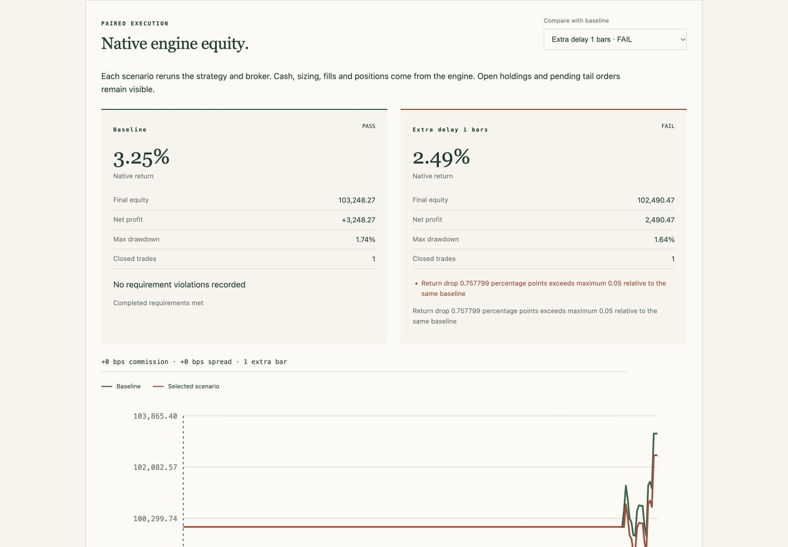

# BacktestWitness

**Find what breaks your strategy. Keep a test for the fix.**

Strategy failure lab for trading bots. Stress real engine costs and delays, investigate failures, and export replayable regression tests.

BacktestWitness reruns your existing strategy with additional native costs and market-order delays. Declare your requirements, inspect the scenario matrix and paired equity/trades, then save a verified failure as a fixture and pytest regression. The first execution backend is **Backtesting.py 0.6.6**. A separate future-data audit workflow remains available.



**Local • No API keys • Offline reports • Python 3.10+ • MIT • 0.3.0 unreleased alpha**

## Try the public failure lab

From this checkout, with Python 3.11+ for the public dependency pins (locally tested on Python 3.12):

```bash
python -m venv .venv
source .venv/bin/activate              # Windows: .venv\Scripts\activate
python -m pip install -e ".[dev,cases]"
backtest-witness lab-cases --output failure-public-output
# Expected exit 1: the bundled variants breach the declared stress policy.
backtest-witness serve --directory failure-public-output
```

Open `http://127.0.0.1:8765`. Select an original public strategy or its disclosed causal variant, inspect a failing scenario, and download its replay artifacts. Secure HTTP preview supports macOS/Linux; on other platforms, open a trusted generated `index.html` directly.

The casebook uses pinned MIT examples from Riskkit and CoinGlass on frozen **synthetic** tapes. The public policy allows at most **0.05 percentage points** of return deterioration from each variant's own baseline and requires at least one closed trade; minimum return is disabled. Baselines can lose money and remain visible. These are debugging cases, not alpha or historical performance evidence. A causal variant repairs the independently identified future-data dependency; it is not an execution-resilient repair. [Sources, data and scope](docs/public-strategies.md).

## Test your strategy and policy

Install the execution pin with `python -m pip install -e ".[dev,lab]"`. Save `requirements.json`:

```json
{
  "min_return_pct": 0,
  "max_drawdown_pct": 20,
  "max_return_drop_pct": 2,
  "min_closed_trades": 5
}
```

These are illustrative requirements, not a trading recommendation. Return and drawdown are percentages; deterioration is a percentage-point drop from the same baseline. Nullable requirements can be disabled with `null`.

```bash
backtest-witness lab --adapter my_strategy:MyStrategy --engine backtesting \
  --engine-settings '{"cash": 10000, "commission": 0.001}' \
  --data bars.csv --requirements requirements.json --output failure-output
backtest-witness serve --directory failure-output
```

Use an importable Backtesting.py `Strategy` class and one instrument's complete OHLCV history. Config JSON passes strategy parameters to `Backtest.run`. The bounded default suite adds commission, native spread and extra delay separately and together; `--scenarios` accepts a declared suite. Every native invocation counts toward `--max-calls`, including repeatability, reduction and final verification. [Quickstart](docs/quickstart.md), [failure lab guide](docs/failure-lab.md), [integrations and Python API](docs/integrations.md).

## Reproduce, repair, keep the test

A verified stress failure exports `failure-fixture.json`, `test_failure_resilience.py` and `failure-receipt.json`, alongside `report.json` and the offline `index.html`.

```bash
backtest-witness replay-failure failure-output/failure-fixture.json
# Exit 1: saved policy failure reproduced.

python -m pytest failure-output/test_failure_resilience.py
# Expected to fail while the policy breach remains.

backtest-witness replay-failure failure-output/failure-fixture.json \
  --adapter my_strategy:RepairedStrategy --config repaired-parameters.json
```

Replay repeats the current baseline and saved stress against the unchanged tape and requirements. An explicit repair override is printed; engine/version mismatch or unstable observations refuses comparison. A passing repair covers this saved case. Evaluate separate reserved cases to assess whether a change generalizes. A minimum closed-trade requirement helps prevent an inactive replacement from passing.

The lab reduces stress dimensions over declared tested levels while preserving every original bar. Costs can change sizing and future decisions, so failure need not vary monotonically. A reduced scenario is not a global minimum or exact break-even boundary.

## Read execution results correctly

| Result | Meaning |
| --- | --- |
| `FAILURE_FOUND` | Repeated stress breaches your policy; a verified failure can coexist with unavailable scenarios. |
| `BASELINE_FAILED` | The baseline already breaches absolute requirements; stress is not blamed. |
| `NO_FAILURE_OBSERVED` | The completed declared suite meets the requirements. |
| `INCONCLUSIVE` | Unstable, invalid, unsupported or incomplete passing evidence prevents a comparable conclusion. |

The engine supplies actual equity, signed positions, closed trades, open holdings and pending orders for each simulation. Added commission follows native entry/exit charges; added spread follows native entry-price adjustment. One extra delay bar postpones discretionary market entries and manual market closes beyond normal next-open execution. Protective SL/TP brackets retain native timing; open terminal holdings are marked and tail orders stay pending.

Positive delay rejects standalone stop/limit orders, market orders created in `Strategy.init`, and `trade_on_close`. Backtrader, pandas and numeric targets remain future-data audit integrations; they are not execution backends in this release. Explicit execution callbacks own their simulator accounting. [Execution contract](docs/execution-contract.md).

OHLC simulations do not establish live fills, statistical significance, profitability or global robustness. Order-book liquidity, real latency, multi-asset portfolios and maintained forward-validation custody are outside this release.

## Future-data debugging remains available

```bash
python -m pip install -e ".[dev]"
backtest-witness demo --output demo-output
backtest-witness audit --adapter my_strategy:run --data bars.csv --output audit-output
python -m pytest demo-output/leaky/test_future_invariance.py
# Expected to fail for the planted future-data defect.
```

This workflow changes records unavailable at a fixed cutoff, compares earlier signed targets and exports `reproducer.json`, `receipt.json` and `test_future_invariance.py`. `FOUND` establishes the saved dependency; `NO_DEPENDENCY_OBSERVED` covers inspected interventions. Its economic curves are a separate illustrative projection on the original tape, not native engine accounting. Existing engine classes, pandas signals, numeric targets and three-argument callbacks remain supported. [Callback contract](docs/callback-contract.md), [methodology](docs/methodology.md), [position sizing](docs/position-sizing.md).

`backtest-witness cases --output public-output` retains the original public future-data casebook and same-fixture causal replay checks.

## Why use this alongside a backtester?

Established engines already simulate trades, and existing tools offer lookahead checks, stress tests and analytics. BacktestWitness concentrates on the investigation loop: explicit policy → repeatable failure → paired evidence → saved regression → repair replay. It adds an offline dossier and bounded failure search around your engine. Broader compatibility and adoption still need validation with real users.

## Develop and contribute

```bash
python -m pip install -e ".[dev,adapters,cases,lab]"
python -m pytest
python -m build
```

Start with a reproducible false positive/negative, an execution control, an adapter or a clearer report interaction. [Contributing](CONTRIBUTING.md), [architecture](docs/architecture.md), [report schema](docs/report-schema.md), [local verification](docs/verification.md), [release checklist](docs/launch-checklist.md), [GitHub launch details](docs/github-launch.md), [changelog](CHANGELOG.md).

## Prior art and credit

Learn from [Freqtrade lookahead analysis](https://www.freqtrade.io/en/stable/lookahead-analysis/), [SharpeBench](https://github.com/general-liquidity/sharpebench), [QuantStats](https://github.com/ranaroussi/quantstats), [Backtrader](https://www.backtrader.com/) and [Backtesting.py](https://kernc.github.io/backtesting.py/). BacktestWitness makes no first-ever detector or stress-testing claim. Source-level attribution and broader execution backend support are future work.

Licensed under [MIT](LICENSE). Install commands above use the checkout; no PyPI publication or public repository is implied.
