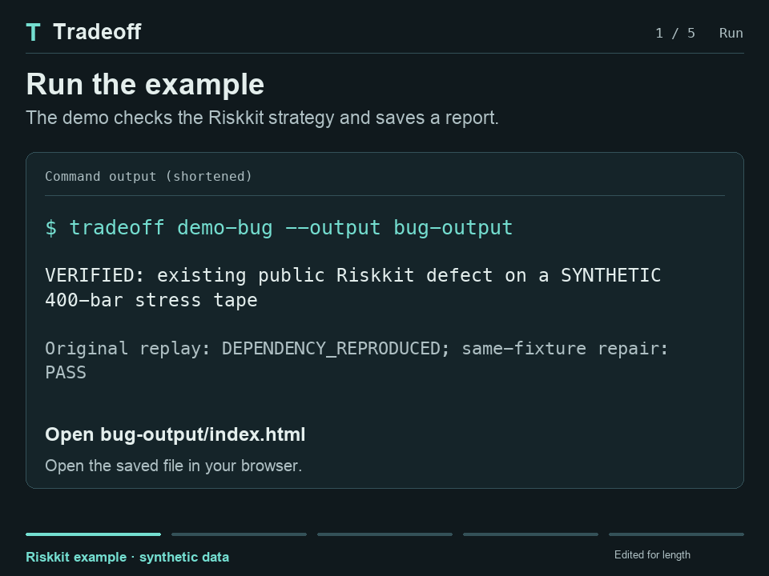

# Tradeoff

Find look-ahead bugs in trading strategies.



26-second demo, edited for length. It uses public Riskkit code and synthetic data. The historical GOOG test found no position change. [Case details](docs/future-data-case-study.md) · [Still image](docs/assets/future-data-investigation.png).

Tradeoff reruns your strategy after changing data it could not have known at the time. If an earlier target or position changes, it saves both sets of inputs and a regression test. Fix the strategy, then rerun the saved test to check the repair.

Start with **Backtesting.py 0.6.6**. There are also adapters for callbacks, pandas, numeric targets and Backtrader. It runs locally and writes an HTML report.

## Try the example

The included Riskkit strategy uses `.bfill()` in its volatility calculation. That lets prices from later bars affect earlier position sizes. The demo runs the original code, finds a position that changes from 29 to 31 units, and checks a fix using the same saved inputs.

The prices are synthetic. The fix changes indicator warmup and skips the original early trades; the strategy still trades after warmup. The original historical GOOG sample showed no position difference under the tested edits, where sizing caps masked the indicator's effect. [Source and test details](docs/future-data-case-study.md).

Use Python 3.12 for the simplest tested setup:

```bash
git clone https://github.com/Toomi16011601/tradeoff.git
cd tradeoff
python3.12 -m venv .venv
source .venv/bin/activate
python -m pip install '.[audit]'
tradeoff demo-bug --output bug-output
```

On Windows, create the environment with `py -3.12 -m venv .venv` and activate with `.\.venv\Scripts\Activate.ps1`.

Open **`bug-output/index.html`** in your browser. It is a file on your computer; no server is needed. The command exits **0** only when it reproduces the original dependency and verifies the repair. It does not certify the entire strategy.


## Connect your own project

Install Tradeoff into your strategy project's environment. Keep your strategy and data in that project:

```bash
python -m pip install 'tradeoff[audit] @ git+https://github.com/Toomi16011601/tradeoff.git'
```

For an importable `Strategy` class in `strategy.py` and a daily CSV with `Date,Open,High,Low,Close,Volume`, run from your project root:

```bash
tradeoff init --strategy strategy.py --data prices.csv \
  --symbol DEMO --timezone America/New_York --session-close 16:00 \
  --timestamp-kind close --review-imports
tradeoff check --json
```

Use your data's symbol, timezone and bar-label convention. For hourly bar-open labels, use `--timestamp-kind open --bar-duration 1h`. A timezone is unnecessary when timestamps already include one. If setup needs more information, it lists the flags to supply. Multiple strategy classes require `--strategy-class MyStrategy`.

`init` reads source without importing it and saves a private `tradeoff.json`. `--review-imports` acknowledges that you reviewed the source, dependencies and companion files; static inspection cannot certify import safety. Recognized unguarded backtest/plot calls must be moved behind `if __name__ == "__main__":` or into a separate script. [Script setup](docs/script-strategy-onboarding.md).

After setup, run **`tradeoff check`** whenever you want another check. Each default run gets a fresh `.tradeoff/` folder. The summary gives the report path and replay command. A coding agent can read `--json` and `report.json`. [Quickstart](docs/quickstart.md) · [Agent workflow](docs/agent-integration.md).

## Repair and verify

When a check finds a bug, keep its `reproducer.json` unchanged. Edit the strategy, then run the printed replay command from your project root. To try a different strategy class:

```bash
tradeoff reproduce .tradeoff/check-RUN/reproducer.json \
  --adapter strategy:RepairedStrategy
```

Replace `check-RUN` with the actual folder printed by your check. Replay exits **1** while the dependency remains, **0** when the saved comparison passes, and **2** for unstable or invalid evidence. Run another `tradeoff check` after the repair to inspect fresh interventions as well.

| Audit result | Meaning |
| --- | --- |
| `FOUND` | A repeated future-only edit changed an observed past target or position. |
| `NO_DEPENDENCY_OBSERVED` | The inspected interventions did not change the tested past decisions. |
| `INCONCLUSIVE` | A comparable result could not be established. |

A pass means the fix works for that saved case. Other look-ahead bugs may remain, and it says nothing about future profit. Tradeoff shows which decisions changed; you or your agent still need to find the cause in the code.

## Local execution and privacy

You run your own copy on your own computer. Once the report is saved, open it as a file. Tradeoff has no built-in upload or AI API requirement. Imported strategies run as ordinary Python, and reports can contain the full input data. If you use a cloud coding agent, that agent controls what it sends to its provider. [Security details](SECURITY.md).

## Other workflows

- **Execution resilience:** native fee, spread and market-order-delay reruns under an explicit policy. [Failure lab](docs/failure-lab.md) · [Historical execution demo](docs/historical-demo.md).
- **Public source casebook:** `tradeoff cases --output public-output` runs two pinned public-code future-data cases and their local repairs. Install `.[cases]` for its numerical pins; Python 3.11+ is required. [Sources and scope](docs/public-strategies.md).
- **Direct integration:** `tradeoff audit` accepts explicit adapters and data options without a project manifest. [Callback contract](docs/callback-contract.md) · [Integrations](docs/integrations.md) · [Methodology](docs/methodology.md).

Related projects: [Freqtrade lookahead analysis](https://www.freqtrade.io/en/stable/lookahead-analysis/), [SharpeBench](https://github.com/general-liquidity/sharpebench), [Backtesting.py](https://kernc.github.io/backtesting.py/) and [Backtrader](https://www.backtrader.com/).

## Develop

```bash
python -m pip install -e '.[dev,adapters,cases,audit]'
python -m pytest
python -m build
```

[Contributing](CONTRIBUTING.md) · [Architecture](docs/architecture.md) · [Report format](docs/report-schema.md) · [Verification](docs/verification.md) · [Changelog](CHANGELOG.md).

Tradeoff is MIT licensed and alpha software. Install from this repository; it is not published on PyPI. Earlier `backtest-witness` commands and `backtest_witness` imports remain compatibility aliases. [Migration](docs/github-launch.md#compatibility-and-earlier-artifacts).
