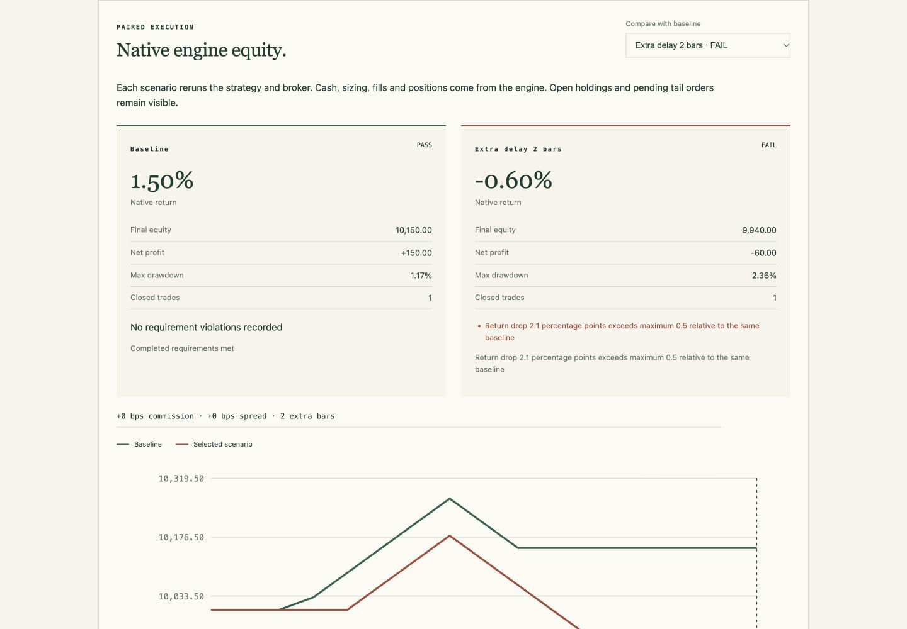

# Tradeoff

**Crash-test a trading strategy before you deploy it. Keep a test for the fix.**

Tradeoff is a local debugging lab for strategies you or your agent already wrote. It runs the strategy in **Backtesting.py 0.6.6**, adds fees, spread and market-order delay, and checks the results against a policy you choose. When it verifies a failure, it saves the evidence and a regression test you can replay after a repair.

**Runs on your device.** Every user installs and runs their own copy. Tests run on that user's computer and save reports there; the project maintainers do not host them or need to keep a computer online. To view a result, open the generated report file in your browser. No server is needed.

```text
Your agent's decisions → Backtesting.py simulates orders
                      → Tradeoff stresses execution and checks your policy
                      → You or a coding agent reads JSON, repairs the strategy, replays the test
```

The browser UI is an interactive report file of a **completed run**. Create new runs with the CLI or Python API. Tradeoff does not choose trades, connect to a live broker or provide a universal agent connector. It needs no AI API keys; passing a simulation does not establish profitability or live execution quality.

**Local • Offline reports • Python 3.10+ • MIT • 0.3.0 alpha**

## Install and try it

Clone this repository onto your own device, then create an environment and install the execution dependencies:

```bash
git clone https://github.com/Toomi16011601/tradeoff.git
cd tradeoff
python -m venv .venv
source .venv/bin/activate
python -m pip install --upgrade pip
python -m pip install '.[lab]'
```

On Windows PowerShell, activate with `.\.venv\Scripts\Activate.ps1`.

Run the included small agent example. It uses synthetic prices so you can try the full workflow before connecting your own strategy:

```bash
python -m examples.agent_integration --output failure-output-agent
# Expected exit 1: this synthetic teaching example breaches its stress policy.
```

Open the generated **`failure-output-agent/index.html`** file in your browser: find it in Finder or File Explorer and double-click it, or use your browser's Open File command. The interactive report contains its data and works offline. It does not need a running server. Use a new or empty output directory for every run.

The example decision function supplies historical buy/close/hold decisions; its adapter places native simulated orders. For shorts, sizing rules and other order behavior, use the native strategy-class interface. A coding agent can call `lab --json` or Python and inspect evidence before proposing a repair. [Agent integration walkthrough](docs/agent-integration.md) · [Step-by-step quickstart](docs/quickstart.md).



*Earlier-version report capture, before the Tradeoff rename. The screenshot still shows the former BacktestWitness name.*

## Test your own strategy

Keep real agent code and private prices in your own project on your device. With the environment active, run from your project's root so its strategy module is importable. Save a [requirements policy](docs/quickstart.md#test-your-own-strategy), then use your existing daily CSV:

```bash
# CSV headers: Date,Open,High,Low,Close,Volume
tradeoff lab --adapter my_strategy:MyStrategy --engine backtesting \
  --data daily.csv --symbol DEMO --timezone America/New_York --session-close 16:00 \
  --requirements requirements.json --output failure-output --json
```

Open **`failure-output/index.html`** from your project folder in your browser. Occupied outputs are rejected before strategy import or simulation; choose a new or empty output directory for later runs.

Choose the symbol, timezone and closing convention for **your** data; no exchange calendar is inferred. Intraday bar-open labels use `--timestamp-kind open --bar-duration 1h`. Extra feature columns and the original source clock are preserved. Native preflight checks some missing columns, unset globals and unusable volume before reruns. It cannot automatically initialize an arbitrary project or fix third-party dependency bugs.

[CSV import, prerequisites and troubleshooting](docs/data-import.md) · [Step-by-step quickstart](docs/quickstart.md) · [Native execution guide](docs/failure-lab.md)

## Read, repair and replay

| Result | Meaning |
| --- | --- |
| `FAILURE_FOUND` | A repeated stressed run breaches your policy; inspect scenario coverage too. |
| `BASELINE_FAILED` | The baseline already breaches your absolute requirements. |
| `NO_FAILURE_OBSERVED` | The completed declared suite meets your policy. |
| `INCONCLUSIVE` | Unstable, unavailable, unsupported or incomplete evidence prevents a comparable conclusion. |

Every run saves `report.json` and an offline `index.html`. A verified stress failure also saves `failure-fixture.json`, `failure-receipt.json` and `test_failure_resilience.py`.

```bash
tradeoff replay-failure failure-output-agent/failure-fixture.json
# Expected exit 1 while the saved policy breach remains.
```

Run this example's replay from the checkout root so its strategy module can be imported. Repair replay checks the current baseline and saved stress against the unchanged tape and policy. A passing repair covers that saved case; it does not establish global robustness. [Repair workflow](docs/quickstart.md#replay-a-repair) · [Artifact schema](docs/report-schema.md)

## Explore further

The public strategy casebook is a larger synthetic debugging example using pinned Riskkit and CoinGlass code. Its causal variants repair independently reproduced future-data defects, not execution resilience. [Public sources and scope](docs/public-strategies.md).

```bash
# Public case pins require Python 3.11+.
python -m pip install '.[cases]'
tradeoff lab-cases --output failure-public-output
# Expected exit 1: the variants breach the declared teaching policy.
```

Open the generated `failure-public-output/index.html` file in your browser.

A separate **future-data audit** changes records unavailable at a fixed cutoff and checks whether earlier decisions change. Its illustrative economic projection is separate from the native execution ledger. Existing Backtrader, pandas and numeric-target integrations retain this audit scope. [Future-data workflow](docs/quickstart.md#future-data-audits) · [Callback contract](docs/callback-contract.md) · [Methodology](docs/methodology.md)

Native execution retains open terminal holdings and pending orders, and preserves native protective SL/TP timing. Some order types are unsupported under added delay. [Execution contract and limits](docs/execution-contract.md).

## Develop and contribute

```bash
python -m pip install -e '.[dev,adapters,cases,lab]'
python -m pytest
python -m build
```

[Contributing](CONTRIBUTING.md) · [Architecture](docs/architecture.md) · [Local verification](docs/verification.md) · [Release checklist](docs/launch-checklist.md) · [Changelog](CHANGELOG.md)

Prior work includes [Freqtrade lookahead analysis](https://www.freqtrade.io/en/stable/lookahead-analysis/), [SharpeBench](https://github.com/general-liquidity/sharpebench), [QuantStats](https://github.com/ranaroussi/quantstats), [Backtrader](https://www.backtrader.com/) and [Backtesting.py](https://kernc.github.io/backtesting.py/). Tradeoff focuses on explicit policy, repeatable failures, paired evidence and repair replay; it makes no first-ever detector claim.

Renamed from BacktestWitness. Existing `backtest-witness` commands and `backtest_witness` Python imports remain compatibility aliases. Saved artifact formats and hashes are unchanged. [Migration details](docs/github-launch.md#compatibility-and-earlier-artifacts).

Licensed under [MIT](LICENSE). Install from this repository; the package has not been published to PyPI.
