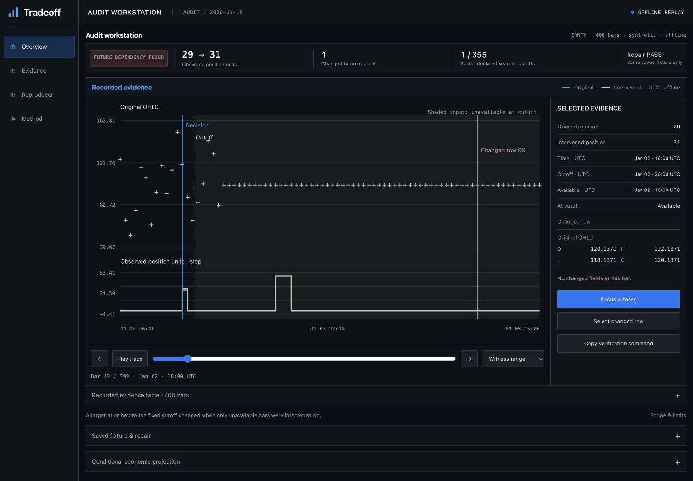

# Tradeoff

**Evidence for trading agents.**

Find future-data bugs. Verify repairs. Review decisions against fills and costs.

Local Python CLI · Agent skill · Optional MCP · MIT



## Let your agent set it up

Give this to a coding agent with local terminal access:

```text
Install the Tradeoff audit skill from:
https://github.com/Toomi16011601/tradeoff/tree/main/skills/tradeoff-audit

Use it to audit this project's strategy and historical data.
Set up the local tool, ask for missing inputs, and show me the report.
Propose repairs before editing strategy code. Leave live trading alone.
```

Already installed? **“Use Tradeoff to audit this project.”**

[Skill setup](skills/tradeoff-audit/references/setup.md) · [Supported integrations](docs/integrations.md)

## Try the demo

Git + Python 3.12. No account or market-data download needed.

```bash
git clone https://github.com/Toomi16011601/tradeoff.git
cd tradeoff
python3.12 -m venv .venv
source .venv/bin/activate
python -m pip install --upgrade "pip>=26.2"
python -m pip install '.[audit]'
tradeoff demo-bug --output bug-output
```

<details>
<summary>Windows PowerShell</summary>

```powershell
git clone https://github.com/Toomi16011601/tradeoff.git
cd tradeoff
py -3.12 -m venv .venv
.\.venv\Scripts\python.exe -m pip install --upgrade "pip>=26.2"
.\.venv\Scripts\python.exe -m pip install '.[audit]'
.\.venv\Scripts\tradeoff.exe demo-bug --output bug-output
```

</details>

Open **`bug-output/index.html`** directly.

The demo tests public Riskkit code on a **synthetic** tape: original failure → saved-case repair verification. The separate historical control found no dependency. [Case study](docs/future-data-case-study.md) · [Troubleshooting](docs/quickstart.md#if-setup-stops)

## What it does

| Workflow | Result |
| --- | --- |
| **Audit** | Change future input and inspect earlier decisions. |
| **Replay** | Test a repair against the saved witness. |
| **Stress** | Rerun native execution with costs and delays. |
| **Feedback** | Match agent intent to fills, costs and outcomes. |

[Audit guide](docs/quickstart.md) · [Failure lab](docs/failure-lab.md) · [Decision feedback](docs/decision-feedback.md)

## Connect your trading agent

In your project's test environment:

```bash
python -m pip install --upgrade "pip>=26.2"
python -m pip install 'tradeoff[mcp] @ git+https://github.com/Toomi16011601/tradeoff.git'
tradeoff connect --project .
```

This prepares local MCP configuration and an agent setup prompt. Your agent still needs an explicit decision hook. [Integration guide](docs/feedback-integration.md)

## Try agent feedback

With Tradeoff installed:

```bash
tradeoff feedback demo --output feedback-output-demo
```

Open **`feedback-output-demo/report/index.html`**. Synthetic decisions; no broker or model required.

## Repair and verify

Keep the saved fixture unchanged. After a repair:

```bash
tradeoff reproduce .tradeoff/check-RUN/reproducer.json
```

Use the actual path from your report. Exit **0**: saved case passes. **1**: dependency remains. **2**: invalid or inconclusive. Then run a fresh audit.

## Local execution and privacy

Runs on your device. Reports open as files. No built-in uploads or AI key required.

Imported strategies execute ordinary Python. Reports retain inputs; your chosen agent controls its provider context. Findings and passes are bounded evidence, not profit guarantees. [Security](SECURITY.md)

## Develop

[Contributing](CONTRIBUTING.md) · [Architecture](docs/architecture.md) · [Verification](docs/verification.md) · [Changelog](CHANGELOG.md)

Alpha software. Install from GitHub; no PyPI release. Legacy `backtest-witness` commands remain compatible.
