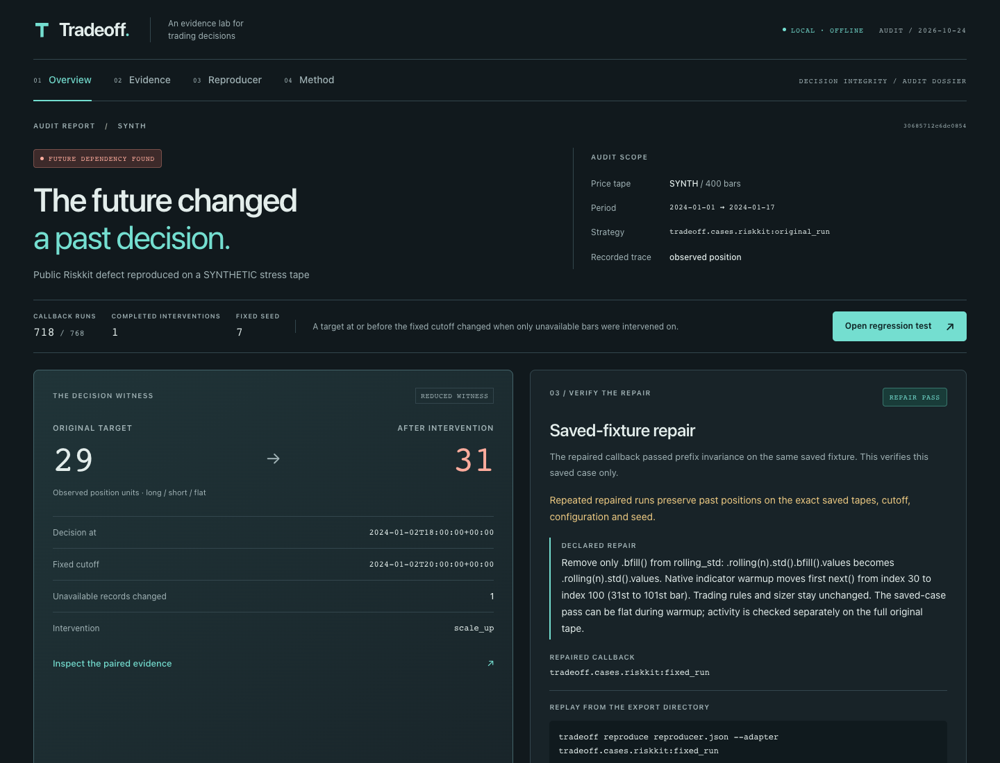

# Tradeoff

**Catch future-data bugs in a trading strategy. Keep a test for the fix.**

Tradeoff changes data that was unavailable at a historical cutoff and reruns your strategy. If an earlier decision changes, it saves the exact paired inputs and a regression test. You or your coding agent can then repair the strategy and replay the **same fixture**.

Start with **Backtesting.py 0.6.6** strategies. Lower-level callback, pandas, numeric-target and Backtrader adapters are also available. Everything runs on your device and writes an offline report file.

## Try a real public-code bug

The included Riskkit example contains a pre-existing `.bfill()` dependency in its published volatility calculation. Tradeoff runs the pinned original code and position sizer, changes only unavailable input, reproduces the earlier position difference, and verifies a disclosed repair against the unchanged fixture.

**The demo input is a synthetic stress tape, not historical market prices.** The defect is in the public source; Tradeoff does not plant it. The longer tape also checks that the repaired strategy still trades. The original full historical GOOG sample did not show a position difference under the tested edits because sizing caps masked the dependency. [Source, evidence and limits](docs/future-data-case-study.md).

Use Python 3.12 for the simplest tested setup:

```bash
git clone https://github.com/Toomi16011601/tradeoff.git
cd tradeoff
python3.12 -m venv .venv
source .venv/bin/activate
python -m pip install '.[audit]'
tradeoff demo-bug --output bug-output
```

On Windows, create the environment with `py -3.12 -m venv .venv` and activate with `.\.venv\Scripts\Activate.ps1`.

Open **`bug-output/index.html`** in your browser. It is a file on your computer; no server is needed. The command exits **0** only when it reproduces the original dependency and verifies the repair. It does not certify the entire strategy.

The report puts the investigation in order: changed unavailable input, affected earlier decision, then saved-fixture repair verification. Detailed tables, saved regression files and conditional economic projections remain available.



## Connect your own project

Install Tradeoff into your strategy project's environment. Keep your strategy and data in that project:

```bash
python -m pip install 'tradeoff[audit] @ git+https://github.com/Toomi16011601/tradeoff.git'
```

For an importable `Strategy` class in `strategy.py` and a daily CSV with `Date,Open,High,Low,Close,Volume`, run from your project root:

```bash
tradeoff init --strategy strategy.py --data prices.csv \
  --symbol DEMO --timezone America/New_York --session-close 16:00 \
  --timestamp-kind close --review-imports
tradeoff check --json
```

Use your data's **actual** symbol, timezone and bar-label convention. For hourly bar-open labels, use `--timestamp-kind open --bar-duration 1h`. A timezone is unnecessary when timestamps already include one. The setup command lists unresolved choices and the flags to supply; you do not need to write a wrapper or edit JSON for a supported importable class. Multiple classes require `--strategy-class MyStrategy`.

`init` reads source without importing it and saves a private `tradeoff.json`. `--review-imports` acknowledges that you reviewed the source, dependencies and companion files; static inspection cannot certify import safety. Recognized unguarded backtest/plot calls must be moved behind `if __name__ == "__main__":` or into a separate script. [Script setup](docs/script-strategy-onboarding.md).

After setup, **`tradeoff check`** is the rerun command. Each default run gets a fresh `.tradeoff/` folder. Its summary gives the report path and replay command. A coding agent can read `--json` and `report.json` directly. [Quickstart](docs/quickstart.md) · [Agent workflow](docs/agent-integration.md).

## Repair and verify

When a check finds a dependency, keep its `reproducer.json` unchanged. From the strategy project root, edit the strategy and run the replay command printed by the check. To try another class explicitly:

```bash
tradeoff reproduce .tradeoff/check-RUN/reproducer.json \
  --adapter strategy:RepairedStrategy
```

Replace `check-RUN` with the actual folder printed by your check. Replay exits **1** while the dependency remains, **0** when the saved comparison passes, and **2** for unstable or invalid evidence. Run another `tradeoff check` after the repair to inspect fresh interventions as well.

| Audit result | Meaning |
| --- | --- |
| `FOUND` | A repeated future-only edit changed an observed past target or position. |
| `NO_DEPENDENCY_OBSERVED` | The inspected interventions did not change the tested past decisions. |
| `INCONCLUSIVE` | A comparable result could not be established. |

A passing saved fixture covers that case. It does not prove global absence of leakage, future profitability or safe live execution. The checker observes decision differences; it does not automatically identify a causal source line.

## Local execution and privacy

Every user runs their own installed copy. Reports need no running process after generation. Tradeoff has no built-in upload or AI API requirement, but imported strategy code executes as ordinary Python. Reports and fixtures can contain the full input tape. Your chosen coding agent controls any files it sends to its provider. [Security boundaries](SECURITY.md).

## Other workflows

- **Execution resilience:** native fee, spread and market-order-delay reruns under an explicit policy. [Failure lab](docs/failure-lab.md) · [Historical execution demo](docs/historical-demo.md).
- **Public source casebook:** `tradeoff cases --output public-output` runs two pinned public-code future-data cases and their local repairs. Install `.[cases]` for its numerical pins; Python 3.11+ is required. [Sources and scope](docs/public-strategies.md).
- **Direct integration:** `tradeoff audit` accepts explicit adapters and data options without a project manifest. [Callback contract](docs/callback-contract.md) · [Integrations](docs/integrations.md) · [Methodology](docs/methodology.md).

Prior work includes [Freqtrade lookahead analysis](https://www.freqtrade.io/en/stable/lookahead-analysis/), [SharpeBench](https://github.com/general-liquidity/sharpebench), [Backtesting.py](https://kernc.github.io/backtesting.py/) and [Backtrader](https://www.backtrader.com/). Tradeoff focuses on saved paired evidence and repair replay; it makes no first-ever detector claim.

## Develop

```bash
python -m pip install -e '.[dev,adapters,cases,audit]'
python -m pytest
python -m build
```

[Contributing](CONTRIBUTING.md) · [Architecture](docs/architecture.md) · [Report format](docs/report-schema.md) · [Verification](docs/verification.md) · [Changelog](CHANGELOG.md).

Tradeoff is MIT licensed and alpha software. Install from this repository; it is not published on PyPI. Earlier `backtest-witness` commands and `backtest_witness` imports remain compatibility aliases. [Migration](docs/github-launch.md#compatibility-and-earlier-artifacts).
