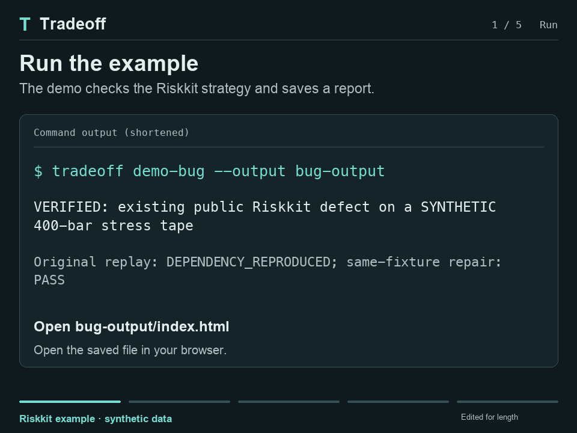
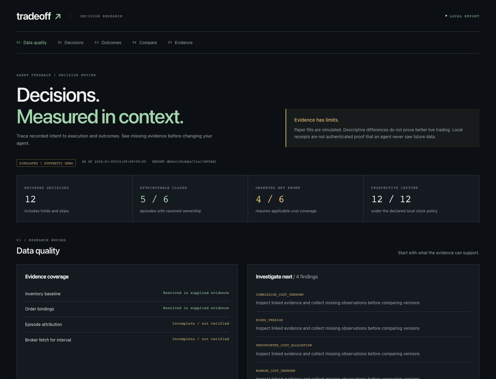

# Tradeoff

Review trading decisions. Verify strategy changes.

Tradeoff is a local evidence tool for trading-agent developers. Record an agent's intent, match execution evidence, check costs and compare declared versions. Its existing audit workflow also finds future-data bugs and saves tests you can rerun after a repair.

**Start here:**

- **[Try the demo](#try-the-demo)** — use the included strategy and prices; no trading project needed.
- **[Let your agent set it up](#let-your-agent-set-it-up)** — give your coding agent a prompt to check your own project.
- **[Try agent feedback](#try-agent-feedback)** — see decisions, fill matching, missing costs and version comparisons; no account or model needed.
- **[Connect your trading agent](#connect-your-trading-agent)** — Python hook or local MCP; wire it once, then record automatically.

Tradeoff runs on **your computer** and writes reports you open as files. Decision feedback supports normalized imports and **read-only Alpaca paper sync**. Future-data audits start with **Backtesting.py 0.6.6**. [Supported integrations and limits](docs/integrations.md).



26-second demo, edited for length. It uses public Riskkit code and synthetic data. The historical GOOG test found no position change. [Case details](docs/future-data-case-study.md) · [Still image](docs/assets/future-data-investigation.png).

## Try agent feedback

You need Git and Python 3.12. Open a terminal and run:

```bash
git clone https://github.com/Toomi16011601/tradeoff.git
cd tradeoff
python3.12 -m venv .venv
source .venv/bin/activate
python -m pip install '.[mcp]'
tradeoff feedback demo --output feedback-output-demo
```

<details>
<summary>Windows (PowerShell)</summary>

```powershell
git clone https://github.com/Toomi16011601/tradeoff.git
cd tradeoff
py -3.12 -m venv .venv
.\.venv\Scripts\python.exe -m pip install '.[mcp]'
.\.venv\Scripts\tradeoff.exe feedback demo --output feedback-output-demo
```

</details>

Open **`feedback-output-demo/report/index.html`** directly. No server, model, account or open market is needed. The synthetic example shows an attributable partial-fill trade, unknown short-borrow costs, mixed-version exclusions and a comparison where the candidate does **worse**. It does not claim trading improvement.

To use your own agent, [prepare its local connection](#connect-your-trading-agent), then give the generated prompt to your agent CLI. Tradeoff records before submission and binds the returned order ID afterward. The existing broker code places orders; Tradeoff only reads evidence. MCP is optional and runs as a stdio process on your device. [Workflow and report guide](docs/decision-feedback.md).



## Connect your trading agent

From your **own trading project's folder**, install once and prepare the local connection:

```bash
python -m pip install 'tradeoff[mcp] @ git+https://github.com/Toomi16011601/tradeoff.git'
tradeoff connect --project .
```

Use your project's Python environment, or an isolated tool environment if dependencies conflict. `connect` generates the MCP entry with the correct paths, an agent setup prompt, and tests recording/binding/retries through Python and real local MCP calls. Its synthetic test runs in a temporary workspace; your trading records stay empty.

Open **`.tradeoff/feedback/connection/AGENT_SETUP.md`**. It explains how to register the generated configuration and gives your coding agent the prompt to wire your real decision hook. Tradeoff cannot attach itself to an arbitrary agent: that hook needs one integration and a fake-broker test.

Then run:

```bash
tradeoff doctor --project .
```

The doctor checks setup and recorded evidence without changing your project. It gives specific next steps for missing bindings, orders/fills, inventory, costs and outcome marks. `SETUP_READY` means the installed tools passed the isolated test; your real agent hook remains `NOT_VERIFIED` until you review and test it. [Complete setup, Windows and troubleshooting](docs/feedback-integration.md).

## Try the demo

You need **Git** and **Python 3.12**. [Install or check these first](docs/quickstart.md#1-install-from-the-checkout) if you are unsure. The demo includes its strategy and synthetic prices, so no API key, market-data download or open market is required.

**macOS / Linux:** open a terminal in the folder where you want the checkout, then copy this block:

```bash
git clone https://github.com/Toomi16011601/tradeoff.git
cd tradeoff
python3.12 -m venv .venv
source .venv/bin/activate
python -m pip install '.[audit]'
tradeoff demo-bug --output bug-output
```

<details>
<summary>Windows (PowerShell)</summary>

```powershell
git clone https://github.com/Toomi16011601/tradeoff.git
cd tradeoff
py -3.12 -m venv .venv
.\.venv\Scripts\python.exe -m pip install '.[audit]'
.\.venv\Scripts\tradeoff.exe demo-bug --output bug-output
```

These commands use the virtual environment directly; no PowerShell activation-policy change is needed.

</details>

**Expected result:** the terminal prints `VERIFIED`. Open the checkout's **`bug-output`** folder and double-click **`index.html`** to see the report in your browser. No server is needed. To repeat the demo, use a fresh output name such as `--output bug-output-2`.

The report shows an earlier position changing from **29 to 31 units**, followed by a passing repair check on the same saved inputs. The command exits **0** when that full demonstration is verified; an incomplete run exits **2**. [Setup troubleshooting](docs/quickstart.md#if-setup-stops).

The included public Riskkit code uses `.bfill()` in a rolling volatility calculation. Removing it changes warmup and skips early trades; the repaired strategy still trades after warmup. The positive example uses **synthetic prices**. The separate historical GOOG test found no position change under the tested edits. A passing saved-case test does not certify the entire strategy. [Source, data and limits](docs/future-data-case-study.md).

## Let your agent set it up

Open your trading project in a coding agent that can run terminal commands. Paste this prompt; you do not need to clone Tradeoff separately first:

```text
Set up Tradeoff (https://github.com/Toomi16011601/tradeoff) to check this trading project for look-ahead bugs.

Find the strategy and one instrument's historical OHLCV data. Ask me for missing data or unclear timestamp conventions; do not guess. Check that the strategy has a supported adapter, starting with Backtesting.py 0.6.6.

Install with: python -m pip install 'tradeoff[audit] @ git+https://github.com/Toomi16011601/tradeoff.git'
Use the project's test environment, or an isolated environment if dependencies conflict.

Review the strategy and imports, then run tradeoff init with the actual files and data conventions. Use --review-imports only after review. Run tradeoff check --json and give me the result, report filename and command for the next check.

Do not place live trades or change strategy logic during setup. If an adapter or data is missing, explain what is needed instead of claiming the check passed.
```

Your agent may need to ask which strategy or data to use. After setup, run **`tradeoff check`** in that environment for another check. A finding produces evidence to inspect; a no-finding result covers the tested inputs only. [Agent workflow and repair loop](docs/agent-integration.md).

Tradeoff has no built-in upload or AI key requirement. Your chosen coding agent controls any files it sends to its own provider.

## Connect your own project

Prefer to set it up yourself? Install Tradeoff into your strategy project's test environment. Keep your strategy and data in that project:

```bash
python -m pip install 'tradeoff[audit] @ git+https://github.com/Toomi16011601/tradeoff.git'
```

For an importable `Strategy` class in `strategy.py` and a daily CSV with `Date,Open,High,Low,Close,Volume`, run from your project root:

```bash
tradeoff init --strategy strategy.py --data prices.csv \
  --symbol DEMO --timezone America/New_York --session-close 16:00 \
  --timestamp-kind close --review-imports
tradeoff check --json
```

Use your data's symbol, timezone and bar-label convention. For hourly bar-open labels, use `--timestamp-kind open --bar-duration 1h`. A timezone is unnecessary when timestamps already include one. If setup needs more information, it lists the flags to supply. Multiple strategy classes require `--strategy-class MyStrategy`.

`init` reads source without importing it and saves a private `tradeoff.json`. `--review-imports` acknowledges that you reviewed the source, dependencies and companion files; static inspection cannot certify import safety. Recognized unguarded backtest/plot calls must be moved behind `if __name__ == "__main__":` or into a separate script. [Script setup](docs/script-strategy-onboarding.md).

After setup, run **`tradeoff check`** whenever you want another check. Each default run gets a fresh `.tradeoff/` folder. The summary gives the report path and replay command. A coding agent can read `--json` and `report.json`. [Quickstart](docs/quickstart.md) · [Agent workflow](docs/agent-integration.md).

## Repair and verify

When a check finds a bug, keep its `reproducer.json` unchanged. Edit the strategy, then run the printed replay command from your project root. To try a different strategy class:

```bash
tradeoff reproduce .tradeoff/check-RUN/reproducer.json \
  --adapter strategy:RepairedStrategy
```

Replace `check-RUN` with the actual folder printed by your check. Replay exits **1** while the dependency remains, **0** when the saved comparison passes, and **2** for unstable or invalid evidence. Run another `tradeoff check` after the repair to inspect fresh interventions as well.

| Audit result | Meaning |
| --- | --- |
| `FOUND` | A repeated future-only edit changed an observed past target or position. |
| `NO_DEPENDENCY_OBSERVED` | The inspected interventions did not change the tested past decisions. |
| `INCONCLUSIVE` | A comparable result could not be established. |

A pass means the fix works for that saved case. Other look-ahead bugs may remain, and it says nothing about future profit. Tradeoff shows which decisions changed; you or your agent still need to find the cause in the code.

## Local execution and privacy

You run your own copy on your own computer. Once the report is saved, open it as a file. Tradeoff has no built-in upload or AI API requirement. Imported strategies run as ordinary Python, and reports can contain the full input data. If you use a cloud coding agent, that agent controls what it sends to its provider. [Security details](SECURITY.md).

## Other workflows

- **Execution resilience:** native fee, spread and market-order-delay reruns under an explicit policy. [Failure lab](docs/failure-lab.md) · [Historical execution demo](docs/historical-demo.md).
- **Public source casebook:** `tradeoff cases --output public-output` runs two pinned public-code future-data cases and their local repairs. Install `.[cases]` for its numerical pins; Python 3.11+ is required. [Sources and scope](docs/public-strategies.md).
- **Direct integration:** `tradeoff audit` accepts explicit adapters and data options without a project manifest. [Callback contract](docs/callback-contract.md) · [Integrations](docs/integrations.md) · [Methodology](docs/methodology.md).

Related projects: [Freqtrade lookahead analysis](https://www.freqtrade.io/en/stable/lookahead-analysis/), [SharpeBench](https://github.com/general-liquidity/sharpebench), [Backtesting.py](https://kernc.github.io/backtesting.py/) and [Backtrader](https://www.backtrader.com/).

## Develop

```bash
python -m pip install -e '.[dev,adapters,cases,audit]'
python -m pytest
python -m build
```

[Contributing](CONTRIBUTING.md) · [Architecture](docs/architecture.md) · [Report format](docs/report-schema.md) · [Verification](docs/verification.md) · [Changelog](CHANGELOG.md).

Tradeoff is MIT licensed and alpha software. Install from this repository; it is not published on PyPI. Earlier `backtest-witness` commands and `backtest_witness` imports remain compatibility aliases. [Migration](docs/github-launch.md#compatibility-and-earlier-artifacts).
